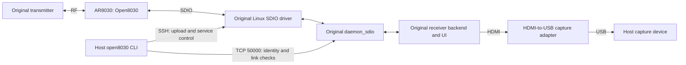

# Architecture

Open8030 replaces the firmware running on the AR8030 radio processor. The tested
system still uses the original transmitter and the receiver's original Linux
SDIO driver, radio daemon, video backend and UI. It is a radio-firmware replacement,
not a replacement for the receiver's complete operating system or video software.
Only the Ascent VRX with matched 18.21.10 inputs has hardware coverage.

## Where the code runs

The diagram shows component relationships, not a claim that every video byte
passes through the UI. Open8030 transports radio payloads; the original Linux
video stack produces the HDMI picture. The host capture adapter is test equipment,
not part of normal radio operation.

## Loading and initialization

1. `./open8030 build` compiles the Zephyr runtime and a separate bootstrap, then
   generates a loader container. No stock image is used as a packaging template.
2. `./open8030 run HOST` uploads that container and a control script into a
   temporary receiver directory. It also copies the receiver's existing
   `bb_config_gnd.json` into that directory.
3. The script verifies the matched software and configuration, stops the original
   services, resets the media-driver state and reloads the original SDIO driver
   with the candidate image. Original firmware files and boot scripts stay intact.
4. The loader supplies the external JSON configuration to the reserved radio RAM
   region. The bootstrap implements the matched low-level setup/reset handshake;
   the runtime's reset hook disables caches and interrupt delivery.
5. The runtime initializes SDIO, socket queues and events. Its loader-based boot
   path validates configuration, probes the chip, reads identity and factory
   information, applies board pins/defaults, calibrates, sets up PSRAM and prepares
   the radio. Preparation holds RF until the original backend supplies candidates
   through its normal control path.
6. The Linux daemon, backend and UI restart. The host checks replacement identity
   and RF link, then retains the RAM session. A separate camera check establishes
   whether a visible scene is reaching HDMI.

See [boot.c](../src/boot.c), [main.c](../src/main.c),
[bootstrap.c](../bootstrap/bootstrap.c) and [vrx.sh](../tools/vrx.sh).
Load addresses alone do not establish boot order: the loader and reset handshake
govern execution.

## Container and memory layout

These are the current generated image's contracts, not a general AR8030 memory map.

| Component | Container offset | Destination | Current size |
| --- | --- | --- | --- |
| Header | `0x0000` | Loader metadata | 64 bytes, padded to 512 |
| Bootstrap | `0x0200` | `0x0a098a00` | 792 bytes, padded to 1,024 |
| Configuration placeholder | `0x0600` | `0x00200000` | 16 KiB, initially zero |
| Runtime | `0x4600` | `0x00204000` | 66,792 bytes, padded to 67,072 |

The complete image is 84,992 bytes. The receiver loader writes its external JSON
into the configuration region; an empty region alone cannot initialize the radio.
The bootstrap uses temporary RAM in that region during its own execution, so the
regions should not be interpreted as independent, permanently resident objects.

The Zephyr board definition reserves 704,512 bytes starting at `0x00204000`.
The recorded build uses 670,816 bytes of that region; the small binary size does
not describe total RAM consumption. These figures do not establish worst-case
stack or DMA margins. Exact hashes and sizes are in [baseline.json](../baseline.json);
the layout generator is [build.py](../tools/build.py).
In the manifest, `generated_container` identifies the current output;
`container` records the earlier accepted image for comparison.

## Runtime and data flow

The hardware build uses a single cooperative loop: multithreading and the Zephyr
system clock are disabled, and RF/SDIO work is polled. This is not yet a complete
interrupt-driven Zephyr platform port. The QEMU build uses UART for protocol
testing and has no physical radio backend.

Each hardware loop receives host frames, services pending socket writes and polls
RF. Outbound events take priority; socket read data and write completions then
alternate. Extra RF polls surround copying/framing work. One SDIO queue entry is
reserved for host replies so bulk traffic cannot consume every reply slot.

Received RF payloads enter bounded copy-mode socket queues. A queue's bytes are
consumed only after SDIO accepts their framed copy. In the other direction, pending
host writes are serviced without blocking RF polling, and bytes are committed
when the RF transport owns a copy. Completion does not prove peer reception.

Important compiled bounds include a 4,096-byte frame payload, four SDIO transmit
queue entries, four socket ports, up to 56,320 receive bytes per port and two
pending writes per port. Active ports can use smaller receive capacities. These
are implementation limits, not CLI tuning parameters.

## Source map

| Files | Responsibility |
| --- | --- |
| `bootstrap/`, `boards/`, `soc/` | Bootstrap, memory layout and CPU/platform setup |
| `src/command.c` | Command expansion, register-field writes, retained metadata and first-match profile updates |
| `src/catalog.c` | Offline-tested channel-catalog serialization and work-list decisions; pending runtime integration |
| `src/channel_work.c` | Offline-tested backup ranking, channel-request staging and auxiliary-scan reset; pending runtime integration |
| `src/channel_policy.c` | Offline-tested selector-1 manual/hopping policy and send/timer decisions; pending runtime integration |
| `src/channel_transaction.c` | Offline-tested queued channel requests, completion and rollback; pending PHY transport and runtime integration |
| `src/channel_link.c` | Offline-tested PHY channel-change callback and monitor preparation; pending link-tuning/transport/runtime integration |
| `src/channel_monitor.c` | Compared monitor decisions; normal mode0 RX8 loss/recovery integrated; channel completion and hopping workers pending |
| `src/phy_control.c` | Compared PHY transport; normal mode0 MCS enqueue/TX/cancel and receive-timer dispatch integrated; channel-policy callbacks pending |
| `src/phy_receive.c` | Compared receive/cache/timer decisions integrated for normal mode0; broader callbacks, mode3 flags and admission remain pending |
| `src/interleaver.c` | Compared source-only drain/retry service and conditional clock correction; TX completion history, ownership and runtime integration pending |
| `src/tx_mcs.c` | Compared source-only MCS requests, initialization, register application and retry-failure events; connected to the interleaver in offline sequence comparisons |
| `src/tune.c` | Compared channel resolution and per-user tuning; runtime use limited to measurement RX11 |
| `src/scan.c`, `scan_scores.c` | Independent measurement scheduling and base-channel averaging; full automatic selection remains unintegrated |
| `src/main.c`, `frame.c`, `dispatch.c` | Polling loop, framing, request dispatch and diagnostics |
| `src/sdio_device.c` | Host transport and bounded SDIO queues |
| `src/boot.c`, `json.c`, `config.c` | Startup and loader configuration |
| `src/rf_device.c` | Hardware register access and integration of RF state machines |
| `src/mac.c`, `dev.c`, `dev_tx.c` | Radio framing, receiver link/login and transmit handling |
| `src/dev_mcs.c`, `fch_monitor.c` | Modulation/coding policy and monitor timing/threshold calculation |
| `src/socket_rx.c`, `event.c` | Host socket streams, completions and events |
| `src/power*.c`, `flash*.c`, `sfdp.c`, `factory*.c` | Calibration planning and read-only factory-data lookup |
| `src/power_control.c` | Compared power-cache ordering and band-offset fields; initial loader user0 application integrated; tuning/host-policy callbacks pending |
| `tools/`, `tests/` | Build/loading tools and offline validation |

## Host protocol

The frame parser in [frame.c](../src/frame.c) accepts fragmented byte streams and
resynchronizes after noise or malformed frames. Its wire layout is:

| Offset | Field | Encoding |
| --- | --- | --- |
| 0 | Start | `0xaa` |
| 1–4 | Payload length | Little-endian unsigned 32-bit, maximum 4,096 |
| 5–8 | Request ID | Big-endian unsigned 32-bit |
| 9–12 | Message ID | Big-endian unsigned 32-bit |
| 13–16 | Status | Big-endian signed 32-bit |
| 17 | Header check | `0xff` XOR bytes 0–16 |
| 18 onward | Payload | Request-specific |
| After payload | End | `0xbb` |

The Linux daemon translates some host requests and message IDs; it is not a
transparent forwarding socket. Project diagnostics use `0x0c5a....` on the chip,
with selected read-only `0x015a....` aliases for forwarding through that daemon.
These are Open8030 extensions, not vendor commands. See
[ar_frame.h](../include/ar_frame.h) for the supported aliases.

The RX diagnostic alias `0x015a0017` requires a four-byte request: little-endian
16-bit byte offset followed by little-endian 16-bit count, at most 1,024 bytes.
The current record is 4,084 bytes; read it in ranges, or read only the required
fields. Empty requests, malformed lengths and out-of-range reads return `-22`
with no payload. Zero-byte reads through the end offset are valid. The direct
`0x0c5a0017` transport retains its complete-record empty request and also accepts
ranges. These diagnostic structures are development interfaces, not stable
vendor APIs; successive ranges are live reads, not one atomic snapshot.

The matched daemon's TCP forwarding wrapper gives its encoder a 4,096-byte
buffer including the 19-byte frame overhead. The complete RX diagnostic exceeds
that limit. Bounded reads avoid the oversized response; increasing the native
SDIO buffer would not fix the daemon's independent limit.

Implemented responses use `-22` for invalid input and `-95` for unsupported
operations. The generic reset request synchronizes the protocol; it does not
reboot the chip or flash firmware. A successful command or payload counter is
not proof of decoded video, latency parity or support for every stock command.

For over-air packet layouts and link behavior, see the [wireless protocol](wireless-protocol.md).
Continue with [configuration](configuration.md), [operation and troubleshooting](operation.md)
and [validation status](status.md).
