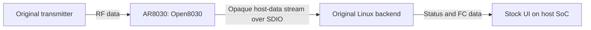

# Telemetry

Telemetry decoding belongs on the receiver's **Linux host SoC**. Open8030 on the
AR8030 transports the original application bytes; the stock receiver backend and
UI validate, decode and present them. No additional host service is required.

## Responsibilities and stock compatibility

In the tested configuration, MAC port 3 maps to host socket 2. Open8030 forwards
this stream through the existing SDIO/daemon path without interpreting MSP,
transmitter-status fields, sensor units or application checksums. Radio framing,
link management and socket transport remain firmware responsibilities.

The receiver's original Linux software already handles both transmitter status
and flight-controller data on that stream. Keeping the original byte format and
socket delivery preserves its stock UI path. Which values the UI displays and
how it handles their age remain properties of that software; Open8030 does not
add a new UI freshness policy.

The experimental stage-231 application decoder, record cache, local-clock API,
`0x0c5a002c` diagnostic (daemon alias `0x015a002c`) and `open8030 telemetry` CLI
were removed in stage 232. The radio no longer duplicates the host's application
parser. Stage-231 results remain historical evidence of the messages observed.

## Recovered application formats

The host stream carries an `fe a5` application envelope with a header checksum,
12-bit payload length, channel/ACK bits, an opaque trailer byte and CRC32C. The
matched Linux backend reassembles this envelope. Its CRC covers the header,
payload and trailer, using reflected polynomial `0x82f63b78`, initial zero and no
final complement. Maximum envelope length is 4106 bytes.

Application type 5 carries transmitter status. The matched backend's dispatcher
and consumers identify byte 1 as signed temperature in °C and LE32 bytes 11–14
as supply millivolts. Application type 2 carries FC bytes; live observations
include MSPv1 and native MSPv2 messages.

| Observed message | Meaning |
| --- | --- |
| Transmitter application type 5 | Transmitter voltage and temperature, among other fields |
| MSP 2 | Flight-controller firmware identifier |
| MSP 3 | Firmware version |
| MSP 101 | FC status, including cycle time, error count and mode/sensor masks |
| MSP 110 | FC battery/analog readings |

These are recovered wire meanings, not a list of fields guaranteed to appear in
the stock UI. Transmitter supply and FC battery voltage are distinct readings.
Received values are not independently calibrated sensor measurements. Zero can
be a real value or reflect sensor configuration. FC mode flags require the active
box mapping before interpreting individual bits.

MSP formats are documented in the public
[Betaflight MSP reference](https://betaflight.com/docs/development/MSP-Protocol-Reference-Dev)
and [message definitions](https://github.com/betaflight/betaflight/blob/master/src/main/msp/msp.c).
No Betaflight decoder is bundled in this firmware.

## Other transport paths and limits

A separate C8 transport path on MAC port 2 can publish original host event 8.
Its framing preserves complete envelopes for the original host interface; it
does not interpret MSP or sensor readings. No live C8 input was observed in this
setup. The existing `0x015a002b` diagnostic reports this bridge and a bounded raw
host-data fragment, without application decoding or field interpretation.

Working host-data telemetry does not establish RC uplink, RC failsafe behavior,
MAVLink, physical UART/SBUS routing, every stock UI field or every operating mode.
See [validation status](status.md) for hardware results and
[wireless protocol](wireless-protocol.md) for the radio transport underneath.
