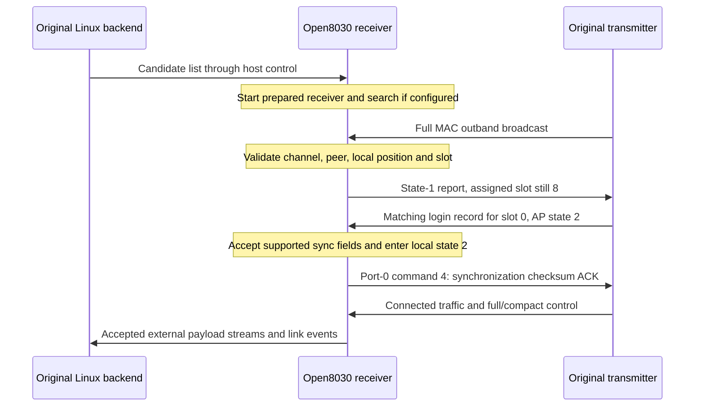

# Wireless protocol

This is an implementation reference for the AR8030 wireless protocol subset used
by Open8030 on the Ascent VRX with matched 18.21.10 inputs. It describes the bytes
and state transitions implemented in this repository. It is not a complete vendor
specification or evidence of interoperability with every AR8030 device.

The receiver operates in **DEV mode 0**, with assigned slot 0 after login. The
original transmitter supplies the AP-side behavior. AP here names a radio role;
it does not mean an IEEE 802.11 access point. Open8030 does not implement the
transmitter/AP role yet.

The packet layouts below describe MAC bytes exposed by the radio hardware and
control fields extracted from its PHY registers. They are not an I/Q or complete
physical-layer encoding specification. Preambles, waveform generation, complete
coding/interleaving maps and all RF timing modes are outside this document's
verified scope.

- [Link-management findings and implementation status](#link-management-findings-and-implementation-status)
- [Layers and terminology](#layers-and-terminology)
- [MAC packet layout](#mac-packet-layout)
- [AP broadcast control](#ap-broadcast-control)
- [Logical peer slots](#logical-peer-slots)
- [DEV uplink report](#dev-uplink-report)
- [Acquisition and login](#acquisition-and-login)
- [Button binding and host coordination](#button-binding-and-host-coordination)
- [Internal command stream](#internal-command-stream)
- [PHY control messages](#phy-control-messages)
- [MCS negotiation](#mcs-negotiation)
- [Timing, retransmission and recovery](#timing-retransmission-and-recovery)
- [Optimization mechanisms and limits](#optimization-mechanisms-and-limits)
- [Error handling and resource ownership](#error-handling-and-resource-ownership)
- [Validation and open questions](#validation-and-open-questions)

## Link-management findings and implementation status

The findings below describe the matched original 18.21.10 firmware. Stages
216–229 added source-only comparisons; stage 230 integrates a selected C8 receive
bridge and transport diagnostics. Stage 232 removes the experimental stage-231
application decoder; transmitter status and MSP decoding belong to the original
Linux host backend/UI. Passing helper tests does not mean every
compared service is present in the running firmware.

| Mechanism | What we have established | Open8030 status |
| --- | --- | --- |
| Acquisition and login | Channel/peer admission, slot assignment, assignment tokens, synchronization acknowledgement and connection invalidation | Integrated for the tested mode-0 DEV, slot-0 path |
| Link-loss recovery | FCH observation monitoring, stopping new submissions, rebuilding saved configuration and resuming reception | Integrated; candidate removal/readmission tested, physical peer silence/restart and pending-DMA recovery need broader hardware coverage |
| AP clock synchronization | Decode transmitter time and maintain a wrapping local offset | Integrated and compared; not an end-to-end latency measurement |
| MCS adaptation | Receive quality window, requested-mode observation, transmit decrease drain and attempt history | Selected paths integrated; sustained adaptation under loss remains unverified |
| Channel measurement and selection | Independent measurement interval, sample/score processing, ranked backup channels and selected hopping-policy decisions | Measurement and scoring integrated with sampling limitations; full selection/hopping policy remains incomplete |
| Internal traffic and resource handling | Framing, route selection, queue admission, worker delivery, ownership and construction failures | Recent helpers compared offline; internal services and their physical backends remain unintegrated |

The receiver progresses through several independent checkpoints: a valid PHY
header, a valid MAC packet, an admitted peer, a connected slot, delivered socket
bytes and visible decoded video. A later checkpoint cannot be inferred solely
from an earlier one. In particular, a connected radio and increasing byte
counters can coexist with a black camera area in the Linux video output.
See [hardware observations](status.md) and the
[comparison scope](parity.md) for the evidence behind these distinctions.

## Layers and terminology

| Layer or term | Meaning in this implementation |
| --- | --- |
| PHY / FCH | Hardware radio processing and frame control header; exposes valid-header, coding and short control-message information |
| MAC packet | A `0x58` packet containing descriptors, outband control and contiguous payloads |
| Outband | Control bytes inside the MAC packet, separate from its payload descriptors; not a separate RF channel |
| AP full/compact control | Transmitter broadcasts interpreted by the receiver's link state machine |
| DEV report | Receiver-to-transmitter status report, with a different layout from AP control |
| Port 0 | Internal command byte stream carried in MAC payloads |
| MAC ports 1–4 | External byte streams mapped to host socket ports 0–3 |
| SDIO host frame | The separate `0xaa … 0xbb` protocol between Linux and the chip; described in [architecture](architecture.md#host-protocol) |

Radio identities are four bytes in wire order. Channel fields are indices into
the configured frequency list, not frequency values. Logical PHY users, assigned
link slots, hardware buffer users and socket ports are separate namespaces. In
particular, logical receive user 8 maps to buffer user 0 in the implemented mode;
that does not make its protocol slot number 8.

## MAC packet layout

All offsets in this section are relative to the start of the MAC packet.
Multi-byte MAC fields are little-endian.

| Offset | Size | Meaning |
| --- | --- | --- |
| 0 | 1 | Magic `0x58` |
| 1 | 1 | Must be zero; nonzero formats are unsupported |
| 2 | 2 | Header CRC16 |
| 4 | 1 | MAC sequence number |
| 5 | 1 | Opaque field; current DEV encoder writes zero |
| 6 | 1 | Unpadded outband length `O` |
| 7 | 1 | Payload descriptor count `N` |
| 8 | `4 × N` | Payload descriptors |
| `H = 8 + 4 × N` | `O` | Outband control |
| `H + O` | 0–3 | Padding to a four-byte boundary |
| `H + align4(O)` | Variable | Payloads concatenated in descriptor order |

Each descriptor is a 32-bit word:

```text
31                         12 11       8 7                 0
+----------------------------+----------+------------------+
| payload length (20 bits)   | flags    | MAC port         |
+----------------------------+----------+------------------+

word = (length << 12) | (flags << 8) | port
```

For example, bytes `03 a3 00 00` encode `0x0000a303`: port 3, flags 3 and
10 payload bytes. Descriptor flags are preserved by the generic parser but are
not assigned general semantics here; the DEV uplink encoder writes zero.

The CRC16 covers **only the MAC header and descriptors**, exactly `H` bytes.
Bytes 2 and 3 are treated as zero while calculating it. The algorithm starts at
zero, processes each byte most-significant bit first with polynomial `0x1021`,
and uses no final XOR. The result is stored little-endian. This software check
does not cover the outband or payload bytes.

The decoder validates every described extent before exposing payload views.
Trailing DMA padding is accepted but excluded from the decoded wire length.
The generic format allows 255 descriptors and a 20-bit length per descriptor;
actual buffers and the current transmit path impose much smaller limits. The
encoder allows at most 252 outband bytes, because a padded extent of 256 is not
supported by the matched transmit contract.

The sequence byte wraps at 256. The MAC parser exposes it; it does not implement
a generic sequence-based acknowledgement or duplicate-suppression mechanism.
Source: [mac.c](../src/mac.c), [ar_mac.h](../include/ar_mac.h).

## AP broadcast control

AP control is carried in the MAC outband region. There are two distinct forms.

### Full form

The full-form decoder accepts an input extent of 32–200 bytes. Byte 0 declares
the control length, which must be at least 32 and fit the supplied extent.
Offsets below are relative to the outband start.

| Offset | Size | Interpretation |
| --- | --- | --- |
| 0 | 1 | Declared control length |
| 1 | 1 | Control sequence, separate from the MAC sequence |
| 2 | 1 | Lookup-based checksum |
| 3 | 1 | Mode in bits 0–1; relay bit 5; bit 6 influences acquisition hardware setup |
| 4 | 1 | Slot bitmap |
| 5 | 1 | Not interpreted by the full-form parser |
| 6 | 1 | Receive-channel index as named by the implementation |
| 7 | 1 | Transmit-channel index |
| 8 | 4 | Peer identity |
| 12 | 16 | Eight little-endian 16-bit slot records |
| 28 | 4 | Extension bitmap |
| 32 onward | Variable | Present extensions, in increasing bit order |

The names of the channel fields follow the implementation. The supported
connection path requires both to match the receiver's current channel; it does
not implement an independently negotiated uplink frequency.

Slot records are interpreted in context: the low three bits participate in
availability checks, bits 1–2 encode AP state during login/connected operation,
and the high byte is a token used to detect stale assignments. These overlapping
interpretations are not independent Boolean flags.

Only extension bits 0, 1, 2, 3 and 5 are accepted (`bitmap & ~0x2f` must be zero).

| Bit | First byte | Extent and use |
| --- | --- | --- |
| 0 | Slot bitmap | One byte plus ten bytes per set bit; login records in ascending slot order |
| 1 | Slot bitmap | One byte plus one byte per set bit; parser exposes the bytes without general effects |
| 2 | Address count | One byte plus four bytes per address; locates the local identity in the AP's list |
| 3 | Byte count | One byte plus that many bytes; bounded view exposed by the parser |
| 5 | Value | One byte; bounded view exposed by the parser |

For bits 0 and 1, an empty bitmap has the matched reader's unusual **zero-byte
extent**: the parser examines the byte but does not advance past it. Bit 4 and
higher unknown bits are rejected. Parsed extension support does not imply that
every extension's runtime effect is implemented.

A bit-0 login record has ten bytes:

| Record offset | Size | Meaning |
| --- | --- | --- |
| 0 | 1 | Token; must match the corresponding slot record's high byte |
| 1 | 1 | Reported login value, retained for diagnostics |
| 2 | 4 | Receiver identity |
| 6 | 4 | Remote synchronization bytes |

The extension bitmap determines the slot number; records are packed and do not
contain a separate slot-index field.

### Compact form

A compact control message is exactly six bytes:

| Offset | Interpretation |
| --- | --- |
| 0 | Lookup-based checksum of bytes 1–5 |
| 1 | Sequence |
| 2 | Assignment token |
| 3 | State in bits 0–1; slot flag in bit 2 |
| 4 | Status flags in bits 0–2; low five power-index bits in bits 3–7 |
| 5 | Power-index bit 5 in bit 0; other bits are not interpreted here |

It has no peer identity, channel list, mode or slot bitmap. Open8030 only applies
its token/state to an already active state-2, slot-0 connection. It cannot admit
a new peer. A changed token or a state other than 2 invalidates that connection.
Other decoded fields are not a claim of implemented dynamic power control.

### Lookup checksum

The full and compact forms share the release-specific `ar_mac_crc8_step` lookup
behavior. It is not interchangeable with an arbitrary standard CRC-8 routine.
For an eight-bit index less than 248, XOR the following basis values for each set
bit, from bit 0 through bit 7:

```text
04 08 10 20 23 25 29 31
```

Indices 248–255 return zero. Starting from accumulator zero, update it with
`step(accumulator XOR byte)`. The full form processes its declared length with
byte 2 treated as zero and compares the result with byte 2. The compact form
processes only bytes 1–5 and compares with byte 0.

## Logical peer slots

The recovered full AP control contains **eight logical peer-slot records,
numbered 0–7**. The DEV report also uses **8 as an unassigned sentinel**; it is
not a ninth usable peer slot. The matched transmitter is the AP/coordinator,
and the receiver obtains its assignment during login.

| Term | Meaning and evidence |
| --- | --- |
| Peer-slot record 0–7 | One of eight LE16 entries at full-control offsets 12–27; carries contextual state/availability and an assignment token |
| Assigned slot 0 | The login assignment used by the current connected Open8030 receiver path |
| Assigned slot 8 | Unassigned value, including the idle/acquisition report before successful assignment |
| Selected transmit context | Local acquisition/hardware selection; context 0 can coexist with assigned slot 8 before login |
| Hardware receive user | A separate hardware context, such as logical RX user 8 monitored for FCH loss; it is not peer-slot numbering |

The admission helper searches entries 0–7 for compatible availability. The
normal mode-0 path selects context 0; additional mode-3 decisions exist in the
compared helper but do not establish runtime support for those modes. Login
extension 0 has its own eight-bit bitmap: each set bit identifies a ten-byte
record for that slot, packed in ascending slot order. Thus a bitmap containing
only bits 0 and 3 describes slots 0 and 3, not slots 0 and 1. A matching local
identity and token identify the assignment; state and synchronization checks
must still succeed. A changed assignment token invalidates the existing lock.

**The slot structure suggests provision for multiple peers under one
coordinator.** In the observed roles, that is consistent with one transmitter
coordinating multiple receivers, including their return traffic. This is an
inference from the control structure, not a verified multi-receiver operating
mode or a statement of vendor intent.

Open8030 currently admits and forwards payloads for the tested **mode-0,
slot-0, single-active-peer relationship**. Other candidate identities are
alternatives for acquisition; the candidate list is not a set of simultaneous
links. We have not demonstrated eight concurrent receivers, equal airtime
windows per slot, independent video per slot, multiple aircraft transmitters
feeding one ground receiver, or mesh relaying. The relationship between peer
assignments and a complete multi-peer airtime schedule remains to be established.

Sources: [slot layout](../include/ar_mac.h), [control parsing](../src/mac.c),
[admission and login](../src/dev.c), [runtime integration](../src/rf_device.c)
and [payload forwarding](../src/socket_rx.c).

## DEV uplink report

The current receiver transmits a 16-byte outband report. This is **not** the full
AP control format despite also containing length, checksum and identity fields.

| Offset | Size | Meaning |
| --- | --- | --- |
| 0 | 1 | Length: 16 |
| 1 | 1 | Zero |
| 2 | 2 | CRC16 over all 16 report bytes, with these bytes treated as zero |
| 4 | 1 | State in bits 0–1; assigned slot shifted left by two |
| 5 | 1 | Receive-channel index |
| 6 | 1 | Six-bit slot value plus two raw status-derived bits |
| 7 | 1 | Zero |
| 8 | 4 | Local four-byte identity |
| 12 | 4 | Zero in this no-extension report |

State 0 always reports slot 8, the unassigned sentinel. During acquisition,
selected transmit context 0 and assigned slot 8 coexist until login assigns
slot 0. They must not be substituted for one another. Slot 8 suppresses the
six-bit value; the integration supplies the initial power index for an assigned
slot. The two high status bits preserve observed behavior without asserting
their physical meaning.

This synthetic, control-only packet is an exact vector from
[dev_tx_test.c](../tests/dev_tx_test.c), with invented identity `01 02 03 04`:

```text
58 00 cd d6 00 00 10 00
10 00 a0 fc 21 02 40 00 01 02 03 04 00 00 00 00
```

The first eight bytes are the MAC header: sequence 0, 16 outband bytes and no
payload descriptors. The report has state 1, unassigned slot 8 and channel index
2. `cd d6` and `a0 fc` are separate CRC16 values for the header and report.
This is an offline test vector, not a captured radio packet.

## Acquisition and login

### Who coordinates the exchange

The original transmitter is the **AP/coordinator**. It broadcasts the link
configuration, slot records and login records. Open8030 implements the DEV-side
checks and responses; it does not run the AP's admission or allocation logic.
Here, "login" means joining that radio relationship, not logging into the Linux
host or subscribing to a telemetry socket.

| Participant | Responsibility in the tested path |
| --- | --- |
| Receiver Linux backend | Supplies candidate transmitter identities through host control |
| Original transmitter / AP | Advertises its identity, channels, mode and slot state, then supplies a login record identifying the receiver and its assignment |
| Open8030 receiver / DEV | Validates the advertised relationship, announces its local identity, accepts a supported matching assignment and queues the synchronization ACK |

The receiver initially reports **slot 8 (unassigned)** even though it has selected
local transmit context 0. A matching login record binds its identity to a logical
slot and token; the tested connected assignment is **slot 0**. The token must
match the slot record's high byte, so a stale assignment cannot silently retain
the same lock after that token changes. See [logical peer slots](#logical-peer-slots).

### Exchange and receiver checks



The main gates are:

1. **Wire validity.** MAC and control extents/checksums must validate. This alone
   establishes neither peer admission nor a link.
2. **Idle admission.** The full broadcast must match the current channel and
   relay policy. For the normal non-pairing path, the local identity must occur
   at position 0 in extension 2, and the peer must match the configured peer or
   one of at most 100 host-provided candidates. A compatible available slot is
   required. Mode/slot-bitmap changes return a reconfiguration decision rather
   than silently changing the active hardware profile.
3. **Acquisition.** Integration additionally requires the same receive/transmit
   channel. It records the admitted peer, suspends search and enters local state
   1. Hardware transition failure leaves TX held.
4. **Login.** A full control message from that admitted peer must contain a login
   record matching the local identity and slot token. The implemented connected
   path requires assigned slot 0, AP state 2 and `sync[0] == 0`. Nonzero remote
   synchronization flags are not acknowledged as executed.
5. **Local connection.** The runtime queues an internal command-4 ACK containing
   the lookup checksum of all four synchronization bytes, enters local state 2
   and enables the receive MCS policy. State 2 is set before that queued ACK is
   necessarily transmitted; it is not proof of peer receipt of the ACK.

### Acknowledgement and continued coordination

Command 4 acknowledges the supported synchronization bytes from the login
record. It is not an acknowledgement of every video or telemetry packet. Local
state 2 and ACK preparation occur before the later transmit opportunity sends
that ACK; there is no demonstrated additional AP-confirmation round trip that
the receiver waits for before marking itself locally connected. Unsupported
synchronization flags must not be treated as successfully applied.

Subsequent full controls from the admitted peer can invalidate the link on token,
state, mode, bitmap or channel changes. Compact controls can invalidate it by
token/state. External payload forwarding happens after those checks and requires
active state 2, assigned slot 0 and no pending recovery. A full control identifying
a different peer does not authorize delivery of that packet's external payload.

In continuous operation, invalidation requests the deferred stop/rebuild/restart
path described under [recovery](#timing-retransmission-and-recovery). Reacquisition
must satisfy the admission and login checks again. Restoring the radio connection
alone does not establish that the Linux video pipeline has recovered.

The AP's internal policy for selecting among receivers, issuing or replacing
tokens, choosing retry/time-out behavior and allocating multi-peer airtime has
not been fully recovered. The exchange above documents the implemented receiver
path and the transmitter messages it consumes; it is not a complete AP state
machine or proof of simultaneous multi-receiver operation.

The pure admission helper includes decisions for additional modes; that does not
establish support for their RF transitions in the running firmware. DEV mode-0
pairing support and its validation boundaries are described below.
Sources: [dev.c](../src/dev.c), `dev_admit`, `dev_observe_lock` and
`receive_complete` in [rf_device.c](../src/rf_device.c).

## Button binding and host coordination

Binding selects a peer; acquisition and login establish a radio session with that
peer. The matched Linux backend handles receiver button events, starts its
binding worker, requests radio pairing, polls the result and saves the selected
four-byte identity. The radio implements pairing admission and the over-air
exchange. Binding is therefore not solely a host feature.

The original backend's worker uses these commands:

| Request | Role in binding |
| --- | --- |
| `0x01000000` | Read radio status/role before pairing |
| `0x02000002` | Enable or disable pairing using a 14-byte request |
| `0x01000001` | Poll a 164-byte pairing-result record |
| `0x02000004` | Update candidates; the successful workflow first clears them |
| `0x02000003` | Select the discovered peer in the DEV role |

The pairing request contains an enable byte, an AP slot mask (ignored by the
original DEV branch), and three four-byte identities that suppress pairing
interpretation for those peers. Enabling pairing selects a shared zero PHY
identity and sets bit 6 of byte 4 in the DEV report. The ordinary configured-peer
and local-position admission requirements are replaced by the pairing checks
when a matching pairing advertisement is received. Wire validity, channel,
supported mode and login-token checks still apply.

The result contains a slot bitmap at byte 0, eight four-byte peer identities
starting at byte 1, and eight 16-byte measurement records starting at byte 36.
Only bitmap-selected entries are meaningful. Discovery alone does not publish a
completed result: the DEV path records it after matching login reaches state 2.
The stock backend polls at approximately 20 ms intervals within a 30-second
budget, checks repeated identity observations and then disables pairing and
selects the peer. It saves the identity in its Linux-side JSON configuration.
The radio command does not itself persist that file or establish encryption-key
exchange.

A physical receiver-button trace on the accepted stage-232 firmware reached
the Linux binding worker and sent `0x02000002` once, with enable and mask both 1.
The backend stopped at its pairing-enable error path because that image did not
implement the command. The current development implementation adds the three
missing commands, the report flag, pairing identity selection and result
publication for DEV mode 0/slot 0. The stage-233 hardware trial completed physical
button binding through the original host worker. The selected peer appeared in
the host's saved list and was admitted again after a receiver reboot and firmware
reload. Synthetic peripheral tests additionally cover an unknown peer's
acquisition/login and host selection; the physical test used the existing pair.

Enabling pairing restarts acquisition through deferred RF recovery, after borrowed
receive buffers and DMA are released. Clearing candidates during successful
pairing does not tear down the newly discovered link. Disabling an unfinished
pairing restores normal acquisition, including the saved candidate list; merely
restoring the configured-peer filter can strand a receiver whose active peer came
from that list. The stage-234 cancellation fix reacquires on hardware in about one
second, and repeated disable leaves the recovered link intact.

Final-revision button binding and video acceptance remain open: captures show
video socket drops and image corruption, in addition to the previously observed
warm-load black-camera symptom. This is not yet an accepted hardware baseline or
support for AP, other frame modes or nonzero connected slots.

Sources: [binding.c](../src/binding.c), [dev.c](../src/dev.c),
[dev_tx.c](../src/dev_tx.c), [rf_device.c](../src/rf_device.c), and
[binding tests](../tests/binding_test.c). Matched host disassembly and device logs
are retained privately rather than distributed with this repository.

## Internal data services

MAC stream ports 1 and 2 also carry original internal services. The matched
mode-3 configuration opens both directions on these streams, corresponding to
host socket ports 0 and 1. On DEV, they serve the UART1/SBUS path and an event
bridge respectively. On AP, the second path instead connects UART2. This
explains why stock rejects external opens of those already-owned host ports.

The event bridge wraps supplied data in a 1,024-byte event body: a two-byte
little-endian payload length, the payload, and a cleared tail. Bridge port 0
uses event ID 8. This event representation is distinct from the radio stream's
packet framing, whose parser and routing still need runtime implementation.
Open8030 currently lacks these internal owners. Its host transport accepts all
twelve original event subscriptions, including ID 8. Stage 230 adds a fixed C8
receive-to-event-8 bridge alongside producers 0 and 1; it does not provision
bidirectional internal services. The tested VTX has sent no packets on this C8
stream. Subscription success does not establish live delivery on that path.
The forwarding helper and original
mode-3 graph comparisons are described in
[internal data coverage](parity.md#mode-3-internal-data-graph-and-event-forwarding).

The original internal socket-port-1 parser uses `c8 | L | body | CRC8`:
the one-byte `L` counts body plus CRC, and total frame length is `L + 2`.
The body contains 1..254 bytes. CRC8 uses polynomial `0xd5`, initial zero,
non-reflected bits and no final XOR, over the body only. The parser keeps the
complete envelope when producing a packet; it does not strip these bytes.
It retains fragmented frames, handles ring wraparound and searches again after
invalid length or CRC. Malformed bytes use a separate error-segment path.
This is a recovered internal stream profile, not a new MAC envelope or a claim
of full compatibility with an external protocol. Its implementation
and comparison limits are documented in
[framing coverage](parity.md#internal-socket-port-1-framing).

Flight-controller data is not limited to the internal C8 stream. In the tested
setup, the existing MAC port-3 / host socket-port-2 stream carries a separate
Linux application envelope containing transmitter-status records and MSP
messages. Stage-230 samples validate outer CRCs and inner MSP checksums. Thus
absence of C8 traffic does not mean absence of flight-controller telemetry.
Full application parsing, field meanings and freshness are separate from the
radio's opaque byte transport. See
[live host-data evidence](parity.md#telemetry-receive-integration-and-live-host-data).

Host notifications copy the declared event payload into transport-owned storage.
Unsubscribe stops new publication while preserving queued notifications. The
current cooperative transport holds at most 16 events and 4,096 payload bytes;
it records and rejects overflow. See
[host event coverage](parity.md#host-event-subscriptions-and-copied-transport)
for the original ID/size table, wire comparison and remaining producer gaps.

## Internal command stream

MAC port 0 is a byte stream. A command can span multiple descriptors or packets,
and one descriptor can contain multiple commands. Its envelope is:

| Offset | Size | Meaning |
| --- | --- | --- |
| 0 | 1 | Magic `0x4a` |
| 1 | 1 | Command number |
| 2 | 1 | Payload length, at most 128 |
| 3 | 1 | XOR checksum |
| 4 | Declared length | Command payload |

The XOR of the complete envelope must be zero. The parser retains partial
envelopes, scans for the magic byte after noise, and discards a consumed envelope
on checksum failure. Recognizing and counting a command does not execute it:
the current receive callback primarily records observations. Command 4 is emitted
for the login synchronization ACK; its one-byte payload is the lookup checksum
described above. It is not a generic ACK for every MAC packet.

MAC ports 1–4 map to host sockets 0–3 by subtracting one. Payloads are transported
as opaque byte streams; this MAC layer does not decode video. Applications decide
the contents of each stream, so port numbers alone are not a universal codec or
telemetry specification.

Current DEV transmit packets contain the 16-byte report and at most one payload
descriptor with up to 132 copied bytes. A report-only packet uses 24 bytes; adding
a payload uses `28 + payload_length`. The available hardware budget is rounded
down to a multiple of eight. The synchronization ACK takes priority over host
stream bytes, including when the current budget is too small to send it.

## PHY control messages

The hardware exposes a separate seven-byte control message extracted starting at
bit 28 of the sampled control-header words. This is distinct from MAC outband
and port-0 commands; identical command numbers across layers are not interchangeable.

| Byte | Fields |
| --- | --- |
| 0 | Lookup-based check |
| 1 | Command in bits 0–3; TTL bits 0–3 in bits 4–7 |
| 2 | TTL bit 4 in bit 0; declared payload length in bits 1–3 |
| 3–6 | Payload storage, including unused tail bytes |

The check uses the same lookup step as AP control, starts at zero and processes
bytes 1–6. Byte 6 is ORed with `0xf0` before processing. Unused tail bytes still
affect the check. A completely zero seven-byte message fails: its computed check
is `0x1e`, not zero.

The receiver validates these command lengths before updating its cached message:

| Command | Required payload length | Current effect |
| --- | --- | --- |
| 0 | No fixed length check | Cache/observe; no command effect |
| 1 | 1 | Effect unsupported |
| 2 | 4 | Effect unsupported |
| 3 | 2 | Limited transmit-MCS update; also the command used for outgoing receive-MCS requests |
| 4 | 3 | Effect unsupported |
| 5 | 3 | Effect unsupported |
| 6 | 2 | Update selected RX/TX identity fields |
| 7 | 4 | Update DEV's AP-time offset; exposed through host getter `0x0100000c` |
| 8 | 4 | Effect unsupported; message byte 6 bits 2–3 must be clear |
| 9 | 0 | Cache/timer handling; original descriptor has no callback |

Commands above 9 are rejected. Accepted format does not imply an implemented
effect. For nonzero commands other than 7, TTL 1 or 31 applies immediately; TTL
2–30 schedules application after `floor((TTL - 1) × frame_us / 1000) + 4` ms.
TTL 0 does not schedule a new application. These are frame-relative synchronization
semantics, not an IP hop count. Processing uses a shared cached control message,
not an independent timer queue for every received command.

The original sender also has one pending command slot. A normal countdown sends
the current TTL before decrementing it; a later tick at zero invokes its local
callback and clears the command. TTL 31 persists until cancellation. A compared
helper covers that sender, cancellation and receive-timer dispatch, including
retained payload tails and mode-3 checksum handling. Receive-timer dispatch is
integrated, and normal mode-0 MCS requests use shared enqueue/TX/cancellation.
The runtime channel-policy path and broader outgoing callbacks remain open. See
[transport coverage and boundaries](parity.md#pending-phy-command-transport).

The receive helper now handles normal mode-0 validation, caching and timer
decisions in the runtime. It also compares the original mode-3 header
behavior: only the checksum's low nibble is checked, while the high nibble
provides per-slot retransmission bits. The high nibble of byte 2 supplies a
per-slot disable mask. A matching command-0 record can synthesize an admission
request for an unconnected DEV. Mode-3 side effects and admission remain unintegrated; the runtime reports
synthesized admission as unsupported. The table above describes runtime effects. A cached command 0 or 7 does
not cancel an earlier timer, but its eventual expiry has no registered command
callback. See [receive comparison and limits](parity.md#phy-control-receive-and-cache-replacement).

### AP-time synchronization

Command 7 uses the header's usual TTL bits differently. Timestamp bits 0–27
come from the little-endian word in bytes 3–6, with its high nibble discarded.
Timestamp bits 28–31 come from byte 1 bits 4–7. Byte 2 bit 0 does not contribute
to the 32-bit timestamp. The normal checksum and four-byte length checks still
apply; an invalid message must not replace the time offset.

The receiver stores `offset = AP_ms - local_ms` with unsigned 32-bit arithmetic.
Host getter `0x0100000c` accepts no payload and returns four little-endian bytes
containing `local_ms + offset`, modulo 2³². Before synchronization, it succeeds
with the unavailable value `0xffffffff`. That value can also occur at a valid
clock's wrap boundary; the wire response has no separate validity flag.

The local time base is the continuous 40 MHz hardware counter divided by 40,000,
not the elapsed time since reception started. Stop/start retains the offset;
deinit/init clears it. Receiving command 7 does not arm or cancel the shared
control timer. If it replaces a pending command in the cache, expiration cannot
reapply the old command; the original descriptor has no command-7 timer callback.

The decoder and getter match 2,304 original-instruction emulator cases. The
clock and semaphore/PHY acquisition helpers are intercepted; this is not a
hardware timing measurement. Native integration tests cover malformed controls,
pending-command replacement and lifecycle handling. This implements DEV's AP
clock estimate, not AP-side timestamp transmission or measured video latency.
Sources: [ap_time.c](../src/ap_time.c), [ap_time_test.c](../tests/ap_time_test.c).

For command 6, payload byte 3 bits 0–3 select user 0–9 and bit 4 selects transmit
identity when set. Byte 4 carries the identity value. RX identity updates are
skipped in DEV idle; selected users also update a shared identity field. This
one-byte PHY identity is separate from the four-byte link identity.

## MCS negotiation

The receive MCS policy samples SNR/error observations over an eight-sample window,
chooses among configured rows and advertises changes through PHY command 3.
See [configuration](configuration.md#mcs-policy) for field ranges and timing units.
Internal MCS indices are configuration values plus two; they are not a universal
802.11 MCS numbering scheme.

An outgoing change uses TTL 31, length 2, the assigned slot and
`internal_mcs | 0xc0`. The high bits use the implementation's bandwidth sentinel;
this is not general bandwidth negotiation. A request becomes acknowledged when a
valid received FCH maps to the requested MCS through the board profile's encoding
keys. Observing an unsolicited configured MCS can also update the current policy
row. The acknowledgement here is an observed PHY mode, not a port-0 envelope.

While a request is pending, advertisement phases alternate after groups of five
pre-encode calls. A configured wait timeout can request RX reset without marking
the MCS change complete. Cancellation clears the active command bits rather than
inventing peer acknowledgement.

Incoming command 3 addresses the receiver's **transmit** MCS. Integration accepts
slot 0 and an internal index below 16, validates its normal encoding key, and
applies an increase immediately. Equal targets require no change; another target
is ignored while a decrease is pending. A decrease waits for six user-0
interleaver events and applies on the seventh, then publishes the MCS-change
event. Other users do not advance this drain. This uses the compared original
bookkeeping and register-application helpers, within the existing copy-mode TX
path. Retained-buffer ownership, retry policy, special PHY keys and
sustained adaptation under loss remain unintegrated or unverified. See the
[runtime TX MCS validation limits](parity.md#runtime-tx-mcs-drain-integration).

During a pending decrease, user-0 pre-encode attempts also update the compared
history mask. An attempt can be recorded even if packet construction subsequently
fails; the mask is not a peer acknowledgement or completion count. Paired bank
bits are used when interleave mode is exactly 1. The initialized retry limit
remains zero, so this integration does not enable a new retry-failure policy.
See [attempt-history coverage](parity.md#runtime-tx-attempt-history).

## Hardware command preparation

Radio commands execute through a hardware command sequence, separately from
host requests and seven-byte PHY messages. The supported DEV frame contains
broadcast receive, a special-user interval and local transmit, each preceded
by preparation. The original firmware keeps software metadata for that sequence:
raw user, command mode, bandwidth, frequency, calibration bank and a buffer flag.

The original preparation routine uses a cursor into this metadata. On a prepare
notification it advances the cursor, checks the raw user and, when necessary,
searches using the original user/mode matching rules. A selected entry supplies
the logical user, direction and frequency to the board callback. Missing or
misaligned metadata can therefore prevent later preparation effects; a local
TX-completion counter alone cannot establish correct preparation or peer reception.

For selected TX metadata, the routine compares its calibration bank with the
cached bank. A change loads five calibration bytes. An initial cache value of 3
also enables compensation and initializes two associated fields. Reusing the
same bank skips those writes. The board callback separately caches its frequency
subrange; at 5,770 MHz it programs six RF controls when that subrange changes.
Additional preparation effects include conditional buffer-control writes and
look-ahead bandwidth programming. Calibration selection, board switching and
TX-buffer ownership are distinct parts of this process.

Open8030 builds the normal DEV frame from three descriptors and retains the
associated metadata. Channel retuning and native profile writes update it.
The normal preparation IRQ now consumes that ring, with the original cursor
advance and fallback matching rules. The fast path checks only the raw user;
the fallback checks both raw user and hardware mode. An unmatched notification
leaves the cursor at -1 and performs no preparation writes. Body notifications
retain the cursor and program look-ahead bandwidth when the next entry is TX.

Selected preparation uses the entry's frequency for board-band selection and
its mode/bank for calibration. Both caches avoid repeated writes. Loaded
compensation survives normal stop/start, deinit/init/start and native recovery.
Probe, default loading, calibration and transitions to/from diagnostic modes
invalidate the caches. Only bank 2 has native calibration data; an unavailable
bank is not substituted with bank 2. Other bands still lack hardware validation.

The preparation helper has original-instruction comparisons for all three
synthetic calibration banks, board-band boundaries, bypass ordering, buffer
flags and work-mode flags. Runtime integration remains the fixed mode-0 DEV
frame. Its copy-mode TX path does not yet carry the original retained-buffer
ownership flags. The independent measurement sweep is integrated as described below; auxiliary
scan callbacks and the board's PA-sleep policy remain unimplemented. Matching helper writes cannot establish these missing
state transitions or interrupt timing. The [parity checklist](parity.md#command-preparation-integration)
records the comparison scope. Low-power acquisition remains unresolved.

### Independent measurement interval

The normal frame includes raw user 13, logical RX user 11. A preceding body
notification advances its channel and writes a separate five-byte PLL shadow.
This sweep can continue while the link's receive and transmit frequencies stay
fixed. Preparation metadata tracks the measurement frequency independently.

The measurement path now uses the generic per-user tuner: five PLL bytes, RF
band/path fields, then retained bank/frequency metadata. Logical RX user 11 skips
the gain-hint fields used by ordinary receive users. The helper also has compared
TX and subchannel-resolution behavior, but those paths are not connected to
runtime channel policy. PLL arithmetic and physical retune timing are separate
comparison boundaries; see [tuning coverage](parity.md#channel-resolution-and-generic-tuning).

Open8030 currently sweeps all 42 configured channels in the tested setup; stock
reports four enabled channels from the same catalog. The original Linux backend
selects that work list after reading the firmware's channel-information getter.
That getter and the work-list setter are not yet integrated in Open8030.

Native power events require a consistent tune and subsequent measurement
preparation; ambiguous polling events are excluded. Admitted events now update
ten raw samples and ten rolling means per channel, followed by the original
integer score conversion. The shared history index advances at the last enabled
channel. Many events are still excluded, so these scores do not establish
equivalent sampling cadence or unbiased RF measurements. Automatic selection,
subchannel processing and auxiliary scans remain unintegrated. See
[score processing and its limits](parity.md#base-channel-score-processing).

## Timing, retransmission and recovery

Channel search follows the configured frequency list. For frame duration `F` in
microseconds, dwell begins at `floor(F / 1000) + 2` ms and alternates at list wraps
with `2 × (floor(F / 1000) + 1)` ms. A first valid candidate control header gets a
two-frame grace period for DMA/admission; repeated unrelated headers cannot keep
extending it. Pending receive DMA or an admitted peer suspends retuning.

The implemented six-step frame duration is derived from hardware duration fields:
three prepare intervals plus broadcast receive, a special-user interval and DEV
transmit. Each 640 ns count is rounded separately to microseconds before summing.
This is not a general frame scheduler or a fixed video frame-rate calculation.

Three mechanisms that can look like acknowledgements are distinct:

| Mechanism | What it establishes |
| --- | --- |
| Login command-4 ACK | Receiver's acknowledgement of the supported synchronization bytes |
| Matching observed FCH MCS | The receive policy sees the requested coding mode |
| TX completion / packet retirement | Local hardware buffer ownership permits reuse; not peer receipt |

The retransmission-request watchdog watches hardware four-bit TLV request IDs,
not the eight-bit MAC sequence. A configured threshold of zero disables it.
Repeated IDs outside `(last + 1) mod 16` or `(last + 2) mod 16` can temporarily
disable TX; a two-call phase then allows re-enabling. This is not a software
implementation of a complete over-air ARQ protocol.

The FCH monitor tracks valid observations for logical receive user 8. Its polling
interval is the rounded frame duration in milliseconds. Loss thresholds preserve
the matched implementation's byte truncation/capping behavior; they should not
be interpreted as an exact one-second timeout. A delayed cooperative poll counts
once rather than manufacturing multiple missed observations.

Continuous operation can request recovery after FCH loss, link invalidation or
removal of an active candidate that is not the configured peer. New submissions
stop immediately. Recovery runs outside packet parsing, stops the radio, rebuilds
the saved configuration while preserving current host candidates, then restarts
reception. RX resets are deferred while receive DMA is pending. Physical
peer-silence/restart and pending-DMA recovery still need broader hardware coverage.

## Optimization mechanisms and limits

The recovered mechanisms manage coding, channel choice, hardware programming
and buffering. Their presence does not establish optimal throughput, latency
or interference tolerance on the tested hardware.

### Coding and channel adaptation

The [MCS policy](#mcs-negotiation) uses an eight-sample SNR/error window and
configured rows to request a receive coding change. Observing the requested PHY
mode confirms the change. A transmit-MCS decrease waits for six user-0
interleaver events and applies on the seventh; this separates a mode request
from the hardware drain needed to apply it. The running copy-mode path covers
these selected transitions, but full retained-buffer retry behavior and
sustained adaptation under interference remain open.

The [independent measurement interval](#independent-measurement-interval) sweeps
frequencies without moving the active link. Admitted samples feed per-channel
history and integer scores. The compared selector-1 policy can rank four backup
channels, advertise them with internal command 10 and arm a 3,000 ms timer.
Those policy effects are compared at queue/send/timer boundaries; they do not
prove peer receipt or a completed physical hop. Open8030 also currently sweeps
42 configured channels where the matched stock backend selects four. Automatic
selection, the normal work-list commands and equivalent measurement cadence
still need integration and validation. See
[channel policy coverage](parity.md#selector-1-channel-policy).

### Hardware preparation and queue pressure

Preparation caches the selected calibration bank and frequency subrange, avoiding
repeated calibration and RF-control writes when they have not changed. Loaded
compensation survives normal stop/start, reinitialization and native recovery;
operations that invalidate the calibration assumptions clear the caches.
This behavior is integrated for the tested board/bank, as described under
[hardware command preparation](#hardware-command-preparation).

The original internal socket-port-1 writer also checks TX occupancy. For nonzero
roles, including the matched DEV role, it suppresses a write above 32 queued
bytes, or above 262 when its mode field equals 1. Equality permits the write.
Suppression returns zero; the route-delivery helper treats that as failure for a
nonempty packet and releases its reference without retry. This is a source-only
comparison, distinct from the running external host socket path. Limiting queued
traffic is a plausible purpose, but a latency benefit has not been measured.
See [internal write-gate coverage](parity.md#internal-socket-write-gate).

## Error handling and resource ownership

Error handling is layered. Wire corruption, failed admission, local congestion
and resource-construction failures have different outcomes; none is a universal
instruction to retry a radio packet.

### Corruption and stream recovery

MAC parsing checks header/descriptor CRC16 and all described extents before
exposing payloads. That CRC does not cover the outband or payload bytes. AP
control and PHY messages have their own checks, and internal command envelopes
use XOR. A valid checksum does not admit a peer or authorize payload forwarding.

The C8 stream parser retains fragmented frames, handles ring wrap
and resumes searching after invalid length or CRC8-D5. It preserves the complete
valid envelope for routing and uses a separate error-segment path for malformed
bytes. Stage 230 integrates it into a fixed receive bridge; full internal-service
provisioning remains open. See
[framing comparison](parity.md#internal-socket-port-1-framing).

### Congestion, discard and packet lifetime

The compared original TX queue distinguishes occupied bytes from bytes available
for acquisition. Its discard option removes available queued bytes while leaving
already acquired bytes occupied. Discard precedes the space check, so a rejected
write can still have changed queue contents. Nonblocking writes can return a
partial count; disabling a queue during a wait can return an error after earlier
passes have published bytes. Callers cannot assume an error means no side effects.
See [TX queue behavior](parity.md#tx-queue-producer-and-backpressure).

The internal worker restores queue capacity after receiving a message and tracks
its age using unsigned tick subtraction. An age greater than **50 ticks** increments
a diagnostic counter; it does not expire the packet. The clock adapter defines
the tick unit, so this comparison does not establish a 50 ms deadline. Explicit
discard releases the packet before transformation or delivery. Missing-packet
and missing-action errors have distinct accounting and ownership effects.
See [worker error handling](parity.md#worker-discard-control-queue-age-and-errors).

Original submission/worker/pool comparisons establish recycling for the tested
non-copying paths. Copying actions retain a reference after the tested workers
drain and can exhaust a synthetic pool. This is not proof of a general stock
memory leak: the 49 recovered built-in route records do not request those copy
actions, and other cleanup/custom-route paths remain open. These helpers still
need production ownership and scheduling integration. See
[pool lifetime](parity.md#submission-worker-delivery-and-original-pool-recycling)
and [built-in route inventory](parity.md#interface-preflight-and-built-in-mode-inventory).

### Partial construction and success reporting

The original service constructor publishes an interface before completing its
reader/writer resources. Later failures can leave published objects and partial
allocations in place. Reader-task and selected mutex errors are ignored at the
compared boundaries, while writer-queue/task failures return errors. A successful
return therefore does not prove that every requested task exists or runs.
The native helper preserves this partial state; callers must manage surviving
resources and serialize construction. Full teardown remains unfinished. See
[service construction](parity.md#interface-publication-and-readerwriter-resources).

The non-UART constructor has another unusual failure path: after a successful
socket open, failure to allocate handle storage frees the interface and returns
zero without publishing it or closing the opened stream at that boundary.
This is recorded behavior, not a guarantee of successful initialization or
cleanup elsewhere. See
[interface construction](parity.md#non-uart-interface-construction-and-profile-selection).

Native bounds, headroom and argument guards deliberately reject some unsafe
inputs that the original does not check. These differences are documented
separately from matching results. Original-instruction comparisons use adapters
at specified hardware/RTOS boundaries; they do not establish real scheduler,
interrupt, allocation or RF failure behavior beyond those boundaries.

### Remaining reliability questions

The retransmission-request watchdog and local TX retirement described above do
not establish complete over-air ARQ, retry limits or peer delivery. Dynamic power
control, physical peer-loss/restart, sustained interference and long-running
resource pressure still need implementation or validation.

Earlier hardware sessions dropped video receive bytes even while video remained
visible. Later clean captures and flow checks have not isolated or fixed that
intermittent loss. A separate black-camera symptom after warm restoration also
remains unresolved. Queue instrumentation helps locate pressure, but neither
passing offline comparisons nor a short successful video check closes these
issues. See [video receive measurements](parity.md#video-receive-flow-measurements)
and [remaining hardware work](status.md#remaining-work).

## Validation and open questions

| Evidence | What it covers |
| --- | --- |
| [mac_test.c](../tests/mac_test.c) | MAC/full/compact parsing, checksum rejection, descriptors, extensions and bounds |
| [dev_test.c](../tests/dev_test.c) | Admission/login decisions, command stream and retransmission watchdog |
| [dev_tx_test.c](../tests/dev_tx_test.c) | Report encoding, synthetic byte vector, budgets and buffer ownership |
| [dev_mcs_test.c](../tests/dev_mcs_test.c) | Receive-MCS policy transitions and timing |
| [fch_monitor_test.c](../tests/fch_monitor_test.c) | Observation/loss logic and timer edge cases |
| [ap_time_test.c](../tests/ap_time_test.c) | DEV AP clock decoding, unavailable state and wrap |
| [rf_device_test.c](../tests/rf_device_test.c) | Simulated hardware integration contracts |
| [Hardware status](status.md) | Matched Ascent VRX native identity/link and visible HDMI camera output |

Checksums detect the errors covered by their algorithms; they are not
cryptographic authentication. This implementation does not establish the complete
vendor encryption, authentication or replay-protection model. It also does not
establish a complete MCS-to-throughput table, all pairing/relay modes, AP-side
timing, incoming frequency reassignment or full telemetry semantics.

Keep separate counts for PHY-valid headers, MAC-valid packets, admitted peers,
state-2 connections, socket-delivered bytes and visible camera frames. Success at
one boundary does not establish success at the next. Unknown fields are left
opaque here rather than assigned meanings unsupported by the implementation.

### Application telemetry decoding

MAC port 3 / host socket 2 carries the original application stream to Linux.
Open8030 treats those payloads as opaque bytes. Application-envelope validation,
transmitter-status interpretation and FC MSP decoding belong to the receiver's
host backend and UI. The experimental stage-231 radio-side observer and its
snapshot endpoint were removed in stage 232. See [telemetry](telemetry.md) for
recovered formats, stock compatibility and the separate C8 UART/event path.
