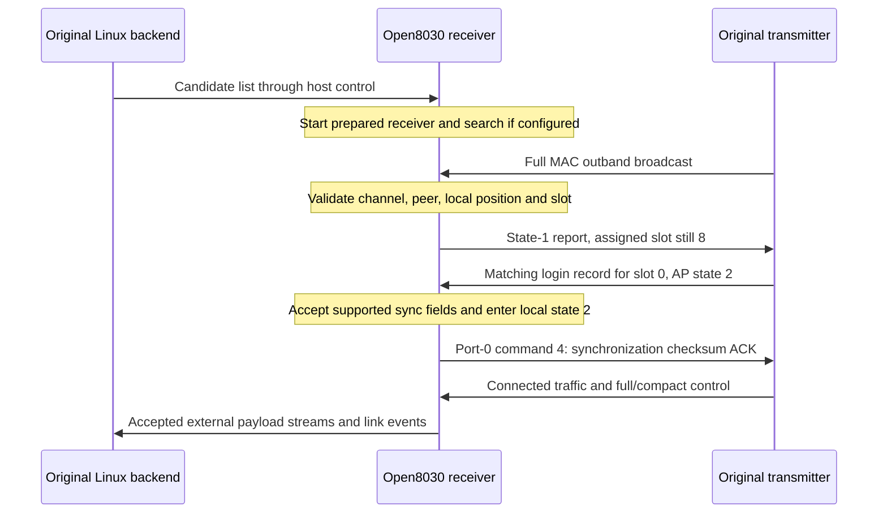

# Wireless protocol

This is an implementation reference for the AR8030 wireless protocol subset used
by Open8030 on the Ascent VRX with matched 18.21.10 inputs. It describes the bytes
and state transitions implemented in this repository. It is not a complete vendor
specification or evidence of interoperability with every AR8030 device.

The receiver operates in **DEV mode 0**, with assigned slot 0 after login. The
original transmitter supplies the AP-side behavior. AP here names a radio role;
it does not mean an IEEE 802.11 access point. Open8030 does not implement the
transmitter/AP role yet.

The packet layouts below describe MAC bytes exposed by the radio hardware and
control fields extracted from its PHY registers. They are not an I/Q or complete
physical-layer encoding specification. Preambles, waveform generation, complete
coding/interleaving maps and all RF timing modes are outside this document's
verified scope.

- [Layers and terminology](#layers-and-terminology)
- [MAC packet layout](#mac-packet-layout)
- [AP broadcast control](#ap-broadcast-control)
- [DEV uplink report](#dev-uplink-report)
- [Acquisition and login](#acquisition-and-login)
- [Internal command stream](#internal-command-stream)
- [PHY control messages](#phy-control-messages)
- [MCS negotiation](#mcs-negotiation)
- [Timing, retransmission and recovery](#timing-retransmission-and-recovery)
- [Validation and open questions](#validation-and-open-questions)

## Layers and terminology

| Layer or term | Meaning in this implementation |
| --- | --- |
| PHY / FCH | Hardware radio processing and frame control header; exposes valid-header, coding and short control-message information |
| MAC packet | A `0x58` packet containing descriptors, outband control and contiguous payloads |
| Outband | Control bytes inside the MAC packet, separate from its payload descriptors; not a separate RF channel |
| AP full/compact control | Transmitter broadcasts interpreted by the receiver's link state machine |
| DEV report | Receiver-to-transmitter status report, with a different layout from AP control |
| Port 0 | Internal command byte stream carried in MAC payloads |
| MAC ports 1–4 | External byte streams mapped to host socket ports 0–3 |
| SDIO host frame | The separate `0xaa … 0xbb` protocol between Linux and the chip; described in [architecture](architecture.md#host-protocol) |

Radio identities are four bytes in wire order. Channel fields are indices into
the configured frequency list, not frequency values. Logical PHY users, assigned
link slots, hardware buffer users and socket ports are separate namespaces. In
particular, logical receive user 8 maps to buffer user 0 in the implemented mode;
that does not make its protocol slot number 8.

## MAC packet layout

All offsets in this section are relative to the start of the MAC packet.
Multi-byte MAC fields are little-endian.

| Offset | Size | Meaning |
| --- | --- | --- |
| 0 | 1 | Magic `0x58` |
| 1 | 1 | Must be zero; nonzero formats are unsupported |
| 2 | 2 | Header CRC16 |
| 4 | 1 | MAC sequence number |
| 5 | 1 | Opaque field; current DEV encoder writes zero |
| 6 | 1 | Unpadded outband length `O` |
| 7 | 1 | Payload descriptor count `N` |
| 8 | `4 × N` | Payload descriptors |
| `H = 8 + 4 × N` | `O` | Outband control |
| `H + O` | 0–3 | Padding to a four-byte boundary |
| `H + align4(O)` | Variable | Payloads concatenated in descriptor order |

Each descriptor is a 32-bit word:

```text
31                         12 11       8 7                 0
+----------------------------+----------+------------------+
| payload length (20 bits)   | flags    | MAC port         |
+----------------------------+----------+------------------+

word = (length << 12) | (flags << 8) | port
```

For example, bytes `03 a3 00 00` encode `0x0000a303`: port 3, flags 3 and
10 payload bytes. Descriptor flags are preserved by the generic parser but are
not assigned general semantics here; the DEV uplink encoder writes zero.

The CRC16 covers **only the MAC header and descriptors**, exactly `H` bytes.
Bytes 2 and 3 are treated as zero while calculating it. The algorithm starts at
zero, processes each byte most-significant bit first with polynomial `0x1021`,
and uses no final XOR. The result is stored little-endian. This software check
does not cover the outband or payload bytes.

The decoder validates every described extent before exposing payload views.
Trailing DMA padding is accepted but excluded from the decoded wire length.
The generic format allows 255 descriptors and a 20-bit length per descriptor;
actual buffers and the current transmit path impose much smaller limits. The
encoder allows at most 252 outband bytes, because a padded extent of 256 is not
supported by the matched transmit contract.

The sequence byte wraps at 256. The MAC parser exposes it; it does not implement
a generic sequence-based acknowledgement or duplicate-suppression mechanism.
Source: [mac.c](../src/mac.c), [ar_mac.h](../include/ar_mac.h).

## AP broadcast control

AP control is carried in the MAC outband region. There are two distinct forms.

### Full form

The full-form decoder accepts an input extent of 32–200 bytes. Byte 0 declares
the control length, which must be at least 32 and fit the supplied extent.
Offsets below are relative to the outband start.

| Offset | Size | Interpretation |
| --- | --- | --- |
| 0 | 1 | Declared control length |
| 1 | 1 | Control sequence, separate from the MAC sequence |
| 2 | 1 | Lookup-based checksum |
| 3 | 1 | Mode in bits 0–1; relay bit 5; bit 6 influences acquisition hardware setup |
| 4 | 1 | Slot bitmap |
| 5 | 1 | Not interpreted by the full-form parser |
| 6 | 1 | Receive-channel index as named by the implementation |
| 7 | 1 | Transmit-channel index |
| 8 | 4 | Peer identity |
| 12 | 16 | Eight little-endian 16-bit slot records |
| 28 | 4 | Extension bitmap |
| 32 onward | Variable | Present extensions, in increasing bit order |

The names of the channel fields follow the implementation. The supported
connection path requires both to match the receiver's current channel; it does
not implement an independently negotiated uplink frequency.

Slot records are interpreted in context: the low three bits participate in
availability checks, bits 1–2 encode AP state during login/connected operation,
and the high byte is a token used to detect stale assignments. These overlapping
interpretations are not independent Boolean flags.

Only extension bits 0, 1, 2, 3 and 5 are accepted (`bitmap & ~0x2f` must be zero).

| Bit | First byte | Extent and use |
| --- | --- | --- |
| 0 | Slot bitmap | One byte plus ten bytes per set bit; login records in ascending slot order |
| 1 | Slot bitmap | One byte plus one byte per set bit; parser exposes the bytes without general effects |
| 2 | Address count | One byte plus four bytes per address; locates the local identity in the AP's list |
| 3 | Byte count | One byte plus that many bytes; bounded view exposed by the parser |
| 5 | Value | One byte; bounded view exposed by the parser |

For bits 0 and 1, an empty bitmap has the matched reader's unusual **zero-byte
extent**: the parser examines the byte but does not advance past it. Bit 4 and
higher unknown bits are rejected. Parsed extension support does not imply that
every extension's runtime effect is implemented.

A bit-0 login record has ten bytes:

| Record offset | Size | Meaning |
| --- | --- | --- |
| 0 | 1 | Token; must match the corresponding slot record's high byte |
| 1 | 1 | Reported login value, retained for diagnostics |
| 2 | 4 | Receiver identity |
| 6 | 4 | Remote synchronization bytes |

The extension bitmap determines the slot number; records are packed and do not
contain a separate slot-index field.

### Compact form

A compact control message is exactly six bytes:

| Offset | Interpretation |
| --- | --- |
| 0 | Lookup-based checksum of bytes 1–5 |
| 1 | Sequence |
| 2 | Assignment token |
| 3 | State in bits 0–1; slot flag in bit 2 |
| 4 | Status flags in bits 0–2; low five power-index bits in bits 3–7 |
| 5 | Power-index bit 5 in bit 0; other bits are not interpreted here |

It has no peer identity, channel list, mode or slot bitmap. Open8030 only applies
its token/state to an already active state-2, slot-0 connection. It cannot admit
a new peer. A changed token or a state other than 2 invalidates that connection.
Other decoded fields are not a claim of implemented dynamic power control.

### Lookup checksum

The full and compact forms share the release-specific `ar_mac_crc8_step` lookup
behavior. It is not interchangeable with an arbitrary standard CRC-8 routine.
For an eight-bit index less than 248, XOR the following basis values for each set
bit, from bit 0 through bit 7:

```text
04 08 10 20 23 25 29 31
```

Indices 248–255 return zero. Starting from accumulator zero, update it with
`step(accumulator XOR byte)`. The full form processes its declared length with
byte 2 treated as zero and compares the result with byte 2. The compact form
processes only bytes 1–5 and compares with byte 0.

## DEV uplink report

The current receiver transmits a 16-byte outband report. This is **not** the full
AP control format despite also containing length, checksum and identity fields.

| Offset | Size | Meaning |
| --- | --- | --- |
| 0 | 1 | Length: 16 |
| 1 | 1 | Zero |
| 2 | 2 | CRC16 over all 16 report bytes, with these bytes treated as zero |
| 4 | 1 | State in bits 0–1; assigned slot shifted left by two |
| 5 | 1 | Receive-channel index |
| 6 | 1 | Six-bit slot value plus two raw status-derived bits |
| 7 | 1 | Zero |
| 8 | 4 | Local four-byte identity |
| 12 | 4 | Zero in this no-extension report |

State 0 always reports slot 8, the unassigned sentinel. During acquisition,
selected transmit context 0 and assigned slot 8 coexist until login assigns
slot 0. They must not be substituted for one another. Slot 8 suppresses the
six-bit value; the integration supplies the initial power index for an assigned
slot. The two high status bits preserve observed behavior without asserting
their physical meaning.

This synthetic, control-only packet is an exact vector from
[dev_tx_test.c](../tests/dev_tx_test.c), with invented identity `01 02 03 04`:

```text
58 00 cd d6 00 00 10 00
10 00 a0 fc 21 02 40 00 01 02 03 04 00 00 00 00
```

The first eight bytes are the MAC header: sequence 0, 16 outband bytes and no
payload descriptors. The report has state 1, unassigned slot 8 and channel index
2. `cd d6` and `a0 fc` are separate CRC16 values for the header and report.
This is an offline test vector, not a captured radio packet.

## Acquisition and login



The main gates are:

1. **Wire validity.** MAC and control extents/checksums must validate. This alone
   establishes neither peer admission nor a link.
2. **Idle admission.** The full broadcast must match the current channel and
   relay policy. For the normal non-pairing path, the local identity must occur
   at position 0 in extension 2, and the peer must match the configured peer or
   one of at most 100 host-provided candidates. A compatible available slot is
   required. Mode/slot-bitmap changes return a reconfiguration decision rather
   than silently changing the active hardware profile.
3. **Acquisition.** Integration additionally requires the same receive/transmit
   channel. It records the admitted peer, suspends search and enters local state
   1. Hardware transition failure leaves TX held.
4. **Login.** A full control message from that admitted peer must contain a login
   record matching the local identity and slot token. The implemented connected
   path requires assigned slot 0, AP state 2 and `sync[0] == 0`. Nonzero remote
   synchronization flags are not acknowledged as executed.
5. **Local connection.** The runtime queues an internal command-4 ACK containing
   the lookup checksum of all four synchronization bytes, enters local state 2
   and enables the receive MCS policy. State 2 is set before that queued ACK is
   necessarily transmitted; it is not proof of peer receipt of the ACK.

Subsequent full controls from the admitted peer can invalidate the link on token,
state, mode, bitmap or channel changes. Compact controls can invalidate it by
token/state. External payload forwarding happens after those checks and requires
active state 2, assigned slot 0 and no pending recovery. A full control identifying
a different peer does not authorize delivery of that packet's external payload.

The pure admission helper includes decisions for additional modes and pairing;
that does not establish support for their RF transitions in the running firmware.
Sources: [dev.c](../src/dev.c), `dev_admit`, `dev_observe_lock` and
`receive_complete` in [rf_device.c](../src/rf_device.c).

## Internal command stream

MAC port 0 is a byte stream. A command can span multiple descriptors or packets,
and one descriptor can contain multiple commands. Its envelope is:

| Offset | Size | Meaning |
| --- | --- | --- |
| 0 | 1 | Magic `0x4a` |
| 1 | 1 | Command number |
| 2 | 1 | Payload length, at most 128 |
| 3 | 1 | XOR checksum |
| 4 | Declared length | Command payload |

The XOR of the complete envelope must be zero. The parser retains partial
envelopes, scans for the magic byte after noise, and discards a consumed envelope
on checksum failure. Recognizing and counting a command does not execute it:
the current receive callback primarily records observations. Command 4 is emitted
for the login synchronization ACK; its one-byte payload is the lookup checksum
described above. It is not a generic ACK for every MAC packet.

MAC ports 1–4 map to host sockets 0–3 by subtracting one. Payloads are transported
as opaque byte streams; this MAC layer does not decode video. Applications decide
the contents of each stream, so port numbers alone are not a universal codec or
telemetry specification.

Current DEV transmit packets contain the 16-byte report and at most one payload
descriptor with up to 132 copied bytes. A report-only packet uses 24 bytes; adding
a payload uses `28 + payload_length`. The available hardware budget is rounded
down to a multiple of eight. The synchronization ACK takes priority over host
stream bytes, including when the current budget is too small to send it.

## PHY control messages

The hardware exposes a separate seven-byte control message extracted starting at
bit 28 of the sampled control-header words. This is distinct from MAC outband
and port-0 commands; identical command numbers across layers are not interchangeable.

| Byte | Fields |
| --- | --- |
| 0 | Lookup-based check |
| 1 | Command in bits 0–3; TTL bits 0–3 in bits 4–7 |
| 2 | TTL bit 4 in bit 0; declared payload length in bits 1–3 |
| 3–6 | Payload storage, including unused tail bytes |

The check uses the same lookup step as AP control, starts at zero and processes
bytes 1–6. Byte 6 is ORed with `0xf0` before processing. Unused tail bytes still
affect the check. A completely zero seven-byte message fails: its computed check
is `0x1e`, not zero.

The receiver validates these command lengths before updating its cached message:

| Command | Required payload length | Current effect |
| --- | --- | --- |
| 0 | No fixed length check | Cache/observe; no command effect |
| 1 | 1 | Effect unsupported |
| 2 | 4 | Effect unsupported |
| 3 | 2 | Limited transmit-MCS update; also the command used for outgoing receive-MCS requests |
| 4 | 3 | Effect unsupported |
| 5 | 3 | Effect unsupported |
| 6 | 2 | Update selected RX/TX identity fields |
| 7 | 4 | Update DEV's AP-time offset; exposed through host getter `0x0100000c` |
| 8 | 4 | Effect unsupported; message byte 6 bits 2–3 must be clear |
| 9 | 0 | Effect unsupported |

Commands above 9 are rejected. Accepted format does not imply an implemented
effect. For nonzero commands other than 7, TTL 1 or 31 applies immediately; TTL
2–30 schedules application after `floor((TTL - 1) × frame_us / 1000) + 4` ms.
TTL 0 does not schedule a new application. These are frame-relative synchronization
semantics, not an IP hop count. Processing uses a shared cached control message,
not an independent timer queue for every received command.

### AP-time synchronization

Command 7 uses the header's usual TTL bits differently. Timestamp bits 0–27
come from the little-endian word in bytes 3–6, with its high nibble discarded.
Timestamp bits 28–31 come from byte 1 bits 4–7. Byte 2 bit 0 does not contribute
to the 32-bit timestamp. The normal checksum and four-byte length checks still
apply; an invalid message must not replace the time offset.

The receiver stores `offset = AP_ms - local_ms` with unsigned 32-bit arithmetic.
Host getter `0x0100000c` accepts no payload and returns four little-endian bytes
containing `local_ms + offset`, modulo 2³². Before synchronization, it succeeds
with the unavailable value `0xffffffff`. That value can also occur at a valid
clock's wrap boundary; the wire response has no separate validity flag.

The local time base is the continuous 40 MHz hardware counter divided by 40,000,
not the elapsed time since reception started. Stop/start retains the offset;
deinit/init clears it. Receiving command 7 does not arm or cancel the shared
control timer. If it replaces a pending command in the cache, expiration cannot
reapply the old command; the original descriptor has no command-7 timer callback.

The decoder and getter match 2,304 original-instruction emulator cases. The
clock and semaphore/PHY acquisition helpers are intercepted; this is not a
hardware timing measurement. Native integration tests cover malformed controls,
pending-command replacement and lifecycle handling. This implements DEV's AP
clock estimate, not AP-side timestamp transmission or measured video latency.
Sources: [ap_time.c](../src/ap_time.c), [ap_time_test.c](../tests/ap_time_test.c).

For command 6, payload byte 3 bits 0–3 select user 0–9 and bit 4 selects transmit
identity when set. Byte 4 carries the identity value. RX identity updates are
skipped in DEV idle; selected users also update a shared identity field. This
one-byte PHY identity is separate from the four-byte link identity.

## MCS negotiation

The receive MCS policy samples SNR/error observations over an eight-sample window,
chooses among configured rows and advertises changes through PHY command 3.
See [configuration](configuration.md#mcs-policy) for field ranges and timing units.
Internal MCS indices are configuration values plus two; they are not a universal
802.11 MCS numbering scheme.

An outgoing change uses TTL 31, length 2, the assigned slot and
`internal_mcs | 0xc0`. The high bits use the implementation's bandwidth sentinel;
this is not general bandwidth negotiation. A request becomes acknowledged when a
valid received FCH maps to the requested MCS through the board profile's encoding
keys. Observing an unsolicited configured MCS can also update the current policy
row. The acknowledgement here is an observed PHY mode, not a port-0 envelope.

While a request is pending, advertisement phases alternate after groups of five
pre-encode calls. A configured wait timeout can request RX reset without marking
the MCS change complete. Cancellation clears the active command bits rather than
inventing peer acknowledgement.

Incoming command 3 addresses the receiver's **transmit** MCS. Integration accepts
slot 0 and an internal index below 16, validates its encoding key, and can apply
an increase. Equal values require no change. Decreases are recorded but not
applied: the required interleaver-drain and buffer-ownership transition is not
implemented. This is a material limit on adaptive-link parity.

## Hardware command preparation

Radio commands execute through a hardware command sequence, separately from
host requests and seven-byte PHY messages. The supported DEV frame contains
broadcast receive, a special-user interval and local transmit, each preceded
by preparation. The original firmware keeps software metadata for that sequence:
raw user, command mode, bandwidth, frequency, calibration bank and a buffer flag.

The original preparation routine uses a cursor into this metadata. On a prepare
notification it advances the cursor, checks the raw user and, when necessary,
searches using the original user/mode matching rules. A selected entry supplies
the logical user, direction and frequency to the board callback. Missing or
misaligned metadata can therefore prevent later preparation effects; a local
TX-completion counter alone cannot establish correct preparation or peer reception.

For selected TX metadata, the routine compares its calibration bank with the
cached bank. A change loads five calibration bytes. An initial cache value of 3
also enables compensation and initializes two associated fields. Reusing the
same bank skips those writes. The board callback separately caches its frequency
subrange; at 5,770 MHz it programs six RF controls when that subrange changes.
Additional preparation effects include conditional buffer-control writes and
look-ahead bandwidth programming. Calibration selection, board switching and
TX-buffer ownership are distinct parts of this process.

Open8030 currently implements the fixed frame, the observed 5–6 GHz TX controls
and a single calibrated context. It does not yet implement the original metadata
cursor and all preparation transitions. In particular, matching gain registers
does not establish equivalent command ordering or calibration lifetime. The
[parity checklist](parity.md#command-preparation-contract-investigation) records
the original-instruction evidence and its limits. The low-power acquisition
failure remains unresolved.

## Timing, retransmission and recovery

Channel search follows the configured frequency list. For frame duration `F` in
microseconds, dwell begins at `floor(F / 1000) + 2` ms and alternates at list wraps
with `2 × (floor(F / 1000) + 1)` ms. A first valid candidate control header gets a
two-frame grace period for DMA/admission; repeated unrelated headers cannot keep
extending it. Pending receive DMA or an admitted peer suspends retuning.

The implemented six-step frame duration is derived from hardware duration fields:
three prepare intervals plus broadcast receive, a special-user interval and DEV
transmit. Each 640 ns count is rounded separately to microseconds before summing.
This is not a general frame scheduler or a fixed video frame-rate calculation.

Three mechanisms that can look like acknowledgements are distinct:

| Mechanism | What it establishes |
| --- | --- |
| Login command-4 ACK | Receiver's acknowledgement of the supported synchronization bytes |
| Matching observed FCH MCS | The receive policy sees the requested coding mode |
| TX completion / packet retirement | Local hardware buffer ownership permits reuse; not peer receipt |

The retransmission-request watchdog watches hardware four-bit TLV request IDs,
not the eight-bit MAC sequence. A configured threshold of zero disables it.
Repeated IDs outside `(last + 1) mod 16` or `(last + 2) mod 16` can temporarily
disable TX; a two-call phase then allows re-enabling. This is not a software
implementation of a complete over-air ARQ protocol.

The FCH monitor tracks valid observations for logical receive user 8. Its polling
interval is the rounded frame duration in milliseconds. Loss thresholds preserve
the matched implementation's byte truncation/capping behavior; they should not
be interpreted as an exact one-second timeout. A delayed cooperative poll counts
once rather than manufacturing multiple missed observations.

Continuous operation can request recovery after FCH loss, link invalidation or
removal of an active candidate that is not the configured peer. New submissions
stop immediately. Recovery runs outside packet parsing, stops the radio, rebuilds
the saved configuration while preserving current host candidates, then restarts
reception. RX resets are deferred while receive DMA is pending. Physical
peer-silence/restart and pending-DMA recovery still need broader hardware coverage.

## Validation and open questions

| Evidence | What it covers |
| --- | --- |
| [mac_test.c](../tests/mac_test.c) | MAC/full/compact parsing, checksum rejection, descriptors, extensions and bounds |
| [dev_test.c](../tests/dev_test.c) | Admission/login decisions, command stream and retransmission watchdog |
| [dev_tx_test.c](../tests/dev_tx_test.c) | Report encoding, synthetic byte vector, budgets and buffer ownership |
| [dev_mcs_test.c](../tests/dev_mcs_test.c) | Receive-MCS policy transitions and timing |
| [fch_monitor_test.c](../tests/fch_monitor_test.c) | Observation/loss logic and timer edge cases |
| [ap_time_test.c](../tests/ap_time_test.c) | DEV AP clock decoding, unavailable state and wrap |
| [rf_device_test.c](../tests/rf_device_test.c) | Simulated hardware integration contracts |
| [Hardware status](status.md) | Matched Ascent VRX native identity/link and visible HDMI camera output |

Checksums detect the errors covered by their algorithms; they are not
cryptographic authentication. This implementation does not establish the complete
vendor encryption, authentication or replay-protection model. It also does not
establish a complete MCS-to-throughput table, all pairing/relay modes, AP-side
timing, incoming frequency reassignment or full telemetry semantics.

Keep separate counts for PHY-valid headers, MAC-valid packets, admitted peers,
state-2 connections, socket-delivered bytes and visible camera frames. Success at
one boundary does not establish success at the next. Unknown fields are left
opaque here rather than assigned meanings unsupported by the implementation.
